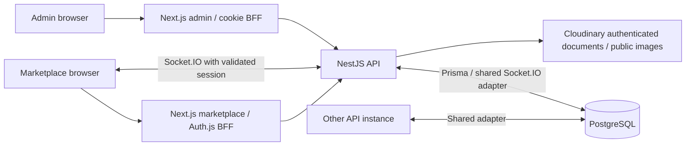

# Porisrom developer handover

Prepared 2026-11-02, Asia/Calcutta. Repository: [luitstudio/porisrom](https://github.com/luitstudio/porisrom), branch `main`.

**Local application, database and Docker acceptance passed. Real staging and production acceptance have not passed.** This document transfers the implemented candidate and its limits; it does not authorize deployment. See the [current acceptance report](PORISROM-STAGING-ACCEPTANCE-REPORT.md) before changing security-sensitive code.

## 1. Project and current status

Porisrom is a professional networking and freelance marketplace. Freelancers build approved public profiles and portfolios; companies/clients discover people and establish connections. An accepted connection supports messaging and structured work: proposals, negotiated terms, acceptance, delivery links, revisions, payment-reference claims and reviews. Administrators review profiles/documents, moderate accounts and reviews, inspect work, resolve escalations and maintain an audit trail. It is not simply a job board.

Roles are `freelancer`, `client` and `admin`; incomplete accounts can have a null role. Account status and profile verification are separate. An approved profile does not override a blocked/deleted account. Profile completion is also separate from document review.

Implemented and locally tested: private document access, refresh rotation/replay handling, HTTP/socket session revocation, moderation, participant block/report, historical read-only access, cancellation escalation, private authenticated support, administrative payment-dispute decisions and durable audit writes. Payment references are participant evidence, not verified bank settlement. There is no implemented escrow, automated refund or bank transfer service.

The [PRD](PRD.md), [API design](api-design.md), [data model](data-model.md) and [roadmap](roadmap.md) explain the domain. Some tables and package READMEs describe earlier states: for example, the backend README still says it is not scaffolded, and the frontend README is starter text. Prefer current code and dated verification reports over those statements.

## 2. Stack, architecture and folders

The verified release toolchain uses **Node 24.11.0**, **pnpm 9.0.0**, Next.js **16.2.9**, React **19.2.4**, Auth.js/NextAuth **5 beta**, NestJS **11**, Prisma **7.8**, PostgreSQL and Socket.IO **4.8.1**. The root `packageManager` pins pnpm; retain `pnpm-lock.yaml`. Root local Compose uses PostgreSQL 16; isolated release/CI/Docker verification used PostgreSQL 18.2. Do not assume verification on one server version proves an unreviewed production upgrade.



Cross-instance rooms/disconnects use the PostgreSQL Socket.IO adapter. The DB must support persistent LISTEN/NOTIFY connections. Browser and Next applications never import the Prisma package for data access.

| Path | Responsibility and useful entry points |
| --- | --- |
| `apps/frontend` | Marketplace App Router, public discovery, auth, onboarding and client/freelancer dashboards. `src/auth.ts`, `src/auth.config.ts`, `src/proxy.ts`, `src/app`, `src/components`, `src/lib`. |
| `apps/admin` | Separate Next app. Protected route group, moderation, payment/safety queues, notifications, analytics and logs. `src/lib/session.ts`, `src/lib/backend-api.ts`, `src/components/nav.tsx`. |
| `apps/backend` | Nest API and all authorization/database/storage access. `src/main.ts`, `src/app.module.ts`, domain modules and `test/`. |
| `packages/database` | Canonical Prisma schema, 14 migrations, generated-client build, taxonomy seed and optional launch data. `prisma/schema.prisma`, `prisma.config.ts`, `src/index.ts`, `src/seed.ts`. Generated client is not committed. |
| `packages/config` | Currently package metadata/README scaffolding; shared executable configs are not implemented here. Apps have their own configs. |
| `packages/shared-types` | Currently an empty exported module, not a complete shared DTO/Zod contract package. Do not assume API types are centralized. |
| `docs` | Product/design records, remediation reports, acceptance evidence summaries, policy decisions and runbooks. |
| `deploy` | Staging Compose/template and synthetic HTTPS/browser acceptance utilities. |
| `scripts` | Guarded native PostgreSQL tests, release verification, backup rehearsal, standalone sanitization and task-specific Docker acceptance. |
| `.github/workflows/verify.yml` | Frozen install, PostgreSQL release checks, four image build targets, sanitized report artifacts; no image publication/deployment step. |
| `Dockerfile`, `.dockerignore` | Separate backend, frontend, admin, migration and acceptance-test targets; non-root app runtimes, standalone Next output. |
| `tmp`, backend upload directories | Local evidence/data only; ignored and deliberately excluded from this publication. |

Turborepo orchestrates root `dev`, `build`, `lint` and `type-check`. Build dependencies are defined in `turbo.json`; run from the workspace root. App-specific commands are often easier to diagnose than starting everything with `pnpm dev`.

## 3. First local setup in Windows PowerShell

These instructions use actual scripts and configured ports. The existing Windows/Docker setup was verified in earlier tasks; this handover does not claim another fresh OS installation or database provisioning run.

### Toolchain and clone

Install Node **24.11.0** using its official Windows installer, reopen PowerShell, then:

```powershell
node --version
npm install --global pnpm@9.0.0
pnpm --version
git clone https://github.com/luitstudio/porisrom.git
Set-Location porisrom
pnpm install --frozen-lockfile
```

Expected versions are `v24.11.0` and `9.0.0`. If pnpm is managed by an existing Corepack installation, use that installation's activation procedure rather than overwriting its shims. Do not regenerate the lockfile to bypass a failed frozen install. Older README recommendations of an unqualified Node 20+ are less precise than this tested version.

### Environment files: copy only when absent

```powershell
$envDirectories = @('packages/database', 'apps/backend', 'apps/frontend', 'apps/admin')
foreach ($directory in $envDirectories) {
  $destination = Join-Path $directory '.env'
  if (-not (Test-Path -LiteralPath $destination)) {
    Copy-Item -LiteralPath (Join-Path $directory '.env.example') -Destination $destination
  }
}
```

Edit those local files in your editor. Replace JWT/Auth.js placeholders with independently generated private values. Keep database URLs in database/backend configuration consistent. Local examples match root Compose's development fixture; those public local-only values are not production credentials. For development, allow both `http://localhost:3000` and `http://localhost:3001` in backend `FRONTEND_ORIGIN` where browser access is required. Never paste real values into docs, tickets, screenshots or terminal output.

### Database: inspect before starting anything

Docker Desktop must be running with a Linux engine. Check the current context and surrounding resources:

```powershell
docker context show
docker version
docker ps --all
docker image ls
docker network ls
docker volume ls
docker compose ls --all
```

On a new developer machine, create a distinct local project so no unidentified volume is reused:

```powershell
$project = 'porisrom-dev-' + [guid]::NewGuid().ToString('N').Substring(0, 8)
docker compose --project-name $project config --quiet
docker compose --project-name $project up --detach postgres
docker compose --project-name $project ps
```

The root `docker-compose.yml` publishes PostgreSQL on loopback **127.0.0.1:5433**, container port **5432**. Its named volume is persistent and scoped by `$project`. If 5433 is occupied, identify its owner; do not kill it or silently reuse its database. Agree an explicit port override and update both local database URLs. Keep `$project` for later scoped stop commands; do not use `down -v`.

Apply existing migrations to this new local DB, then seed catalog data:

```powershell
pnpm --filter @porisrom/database build
pnpm --filter @porisrom/database migrate:deploy
pnpm --filter @porisrom/database seed
```

Database `build` runs Prisma generation and TypeScript compilation. `migrate:deploy` applies committed migrations; do not create a new migration just to start the project. The normal seed provides categories/skills; leave `SEED_LAUNCH_DATA` false unless intentionally creating local demonstrations with your own private password.

### Start three applications in separate terminals

Run each from the repository root:

```powershell
# Terminal 1: API on http://localhost:4000
pnpm --filter @porisrom/backend dev
```

```powershell
# Terminal 2: marketplace on http://localhost:3000
pnpm --filter @porisrom/frontend dev
```

```powershell
# Terminal 3: admin on http://localhost:3001
pnpm --filter @porisrom/admin dev
```

Backend `/health` is liveness; `/health/ready` checks DB and, when configured, the realtime backplane. Local default single-instance sockets use memory. API default `HOST` is `0.0.0.0`; bind to loopback when that is the intended local exposure. Stop apps with their terminal interrupts; stop only your DB project with `docker compose --project-name $project stop` and retain its volume.

Use owner-authorized development accounts or register synthetic local marketplace accounts. For a new local admin, choose your own `ADMIN_EMAIL`/`ADMIN_PASSWORD` in the ignored backend environment, then run:

```powershell
pnpm --filter @porisrom/backend build
pnpm --filter @porisrom/backend seed:admin
```

Read `src/scripts/seed-admin.ts` first; do not use this as an automatic production bootstrap or promote an existing unrelated account. There are no handover/default production credentials.

## 4. Environment variable inventory

Obtain real storage, hosting and database credentials from the project owner using an approved password manager/secret manager with separate environment access. Rotate and scope them deliberately. No email/identity provider has been approved; do not invent its variables or keys.

| Names | Consumer | Meaning / requirement |
| --- | --- | --- |
| `DATABASE_URL` | Database CLI, backend | Private PostgreSQL URL. Required for migrations and API; use `DATABASE_URL=<your-local-database-url>` as documentation only. |
| `JWT_ACCESS_SECRET`, `JWT_REFRESH_SECRET` | Backend | Distinct private signing keys; production validates minimum length and placeholder safety. At least 32 characters each; do not reuse frontend secret. |
| `JWT_ACCESS_EXPIRES_IN`, `JWT_REFRESH_EXPIRES_IN` | Backend | Defaults 15 minutes / 7 days. Frontend has a matching 15-minute access refresh schedule; coordinate any change. |
| `FRONTEND_ORIGIN` | Backend | Comma-separated exact marketplace/admin origins for HTTP CORS and sockets. Production requires HTTPS and rejects wildcard/localhost settings. |
| `BACKEND_PUBLIC_URL` | Backend | Browser-visible API origin for generated public/protected routes. Configure the actual HTTPS API in deployed environments. |
| `PORT`, `HOST` | Backend | Listening port/address; defaults 4000 / `0.0.0.0`. Do not confuse container ports and published ports. |
| `BACKEND_URL` | Frontend/admin servers and Next build | Server-side API origin, required in production; no implicit production localhost fallback. Never contains a credential. |
| `NEXT_PUBLIC_BACKEND_URL` | Marketplace browser/build | Public API/socket origin baked into client build. Required in production; no secrets in any `NEXT_PUBLIC_*` setting. |
| `AUTH_SECRET` | Marketplace Auth.js | Private session encryption/signing secret, independent from both backend JWT keys. |
| `AUTH_URL`, `AUTH_TRUST_HOST` | Marketplace Auth.js | Deployed marketplace origin and trusted-host handling. Configure behind the actual approved proxy, not arbitrary client-forwarded headers. Examples set trust true; actual ingress must be reviewed. |
| `CLOUDINARY_CLOUD_NAME`, `CLOUDINARY_API_KEY`, `CLOUDINARY_API_SECRET` | Backend only | Supported cloud storage configuration. Real cloud private-file acceptance requires approved staging-only credentials. Never send keys to browser. |
| `KYC_LOCAL_FALLBACK_ENABLED` | Backend | Explicit development-only private document fallback; production rejects enabling it. Default/local behavior is validated in `document-storage.ts`. |
| `PRIVATE_DOCUMENT_UPLOAD_DIR` | Backend | Private local PDF root; default backend working directory's `private-uploads`. Never serve it statically. |
| `KYC_DOCUMENT_UPLOAD_DIR` | Backend | Legacy document lookup root only; preserve old references during migration, not a new public upload destination. |
| `PROFILE_PHOTO_UPLOAD_DIR` | Backend | Public upload root; restricted static public image routes. Docker uses a separate runtime public directory/volume. |
| `SOCKET_ADAPTER` | Backend | `memory` for single instance or `postgres` for shared rooms. Multiple instances require PostgreSQL adapter. |
| `SOCKET_CHANNEL_PREFIX` | Backend | Environment-specific channel prefix; validated maximum 40 allowed characters. Keep staging/production namespaces distinct. |
| `REALTIME_EXPECTED_INSTANCES` | Backend | Positive integer peer count for readiness; multiple peers cannot use memory adapter. |
| `ADMIN_EMAIL`, `ADMIN_PASSWORD` | Explicit backend seed only | Owner-selected local bootstrap account; not normal runtime defaults and never publish the values. |
| `SEED_LAUNCH_DATA`, `LAUNCH_DEMO_PASSWORD`, `LAUNCH_DEMO_PROFILE_STATUS` | Database seed | Optional local demonstration data. Password required when enabled; profile status defaults pending. Not a production account mechanism. |
| `POSTGRES_USER`, `POSTGRES_PASSWORD`, `POSTGRES_DB` | Compose DB service | Database initialization configuration; staging template has placeholders. Do not change values to reset an existing volume. |
| `NODE_ENV` | All applications | Production enables secure cookies/configuration guards; do not set development to bypass a failed production check. |
| `HOSTNAME`, `PORT` | Standalone Next containers | Docker binds standalone servers to configured container addresses/3000 or 3001. Ordinary admin scripts already pass port 3001. |
| `PORISROM_NEXT_DEV_DIST_DIR` | Next configs | Optional separate test/development output directory. Do not commit generated directories. |
| `PORISROM_PG_BIN` | Native test provisioner | Windows PostgreSQL binary directory, default PostgreSQL 18 installation path. |
| `PORISROM_AUTH_TEST_DATABASE_URL`, `PORISROM_MODERATION_TEST_DATABASE_URL`, `PORISROM_ADMIN_TEST_DATABASE_URL`, `PORISROM_SAFETY_TEST_DATABASE_URL`, `PORISROM_CLUSTER_TEST_DATABASE_URL` | Integration tests | Explicit isolated test targets; absent URLs skip those suites. Never aim them at development/shared/production records. |
| `PORISROM_SECURITY_TEST_STATE_PATH` | Guarded test fixture tools | Private native cluster-state pointer; generated by wrapper, not a normal app setting. |
| `ACCEPTANCE_FIXTURE`, `ACCEPTANCE_UI_ONLY`, `PORISROM_ACCEPTANCE_SEED_SUFFIX` | Docker browser/seed tools | Synthetic fixture metadata, UI-only diagnostic mode and unique fixture suffix. Not deployed product configuration. |
| `NODE_EXTRA_CA_CERTS` | Synthetic HTTPS test containers | Trust the task's self-signed CA without disabling application TLS verification. Real deployments use reviewed trust configuration. |

`deploy/staging.env.example` is a names-only template, not a runnable credential set. No SMTP, email verification, payment gateway, monitoring destination or production domain is configured by this handover.

## 5. Authentication, permissions and security invariants

- Backend `/auth/signup` and `/auth/login` issue access/refresh tokens; backend cookies are HttpOnly, SameSite=Lax and Secure in production. Marketplace uses a credentials Auth.js BFF; admin uses its own `admin_access_token` / `admin_refresh_token` HttpOnly cookie pair, not Auth.js.
- `AuthSession` stores refresh-token hashes and persisted expiry/revocation/reuse state. Refresh uses an atomic conditional update: one concurrent rotation wins. A short collision window returns conflict without destroying the winner; later replay revokes the session. Preserve client refresh coordination and conflict behavior.
- HTTP JWT validation checks persisted session and current account state. Logout revokes backend state, including refresh-token-supported logout when access has expired; frontend/admin must not claim revocation success after failure. Marketplace currently redirects home after sign-out.
- Sockets authenticate the same session, enforce expiry and validate authorization on packets/delivery. PostgreSQL adapter propagates session/account disconnects across instances. Never cache a one-time connection decision as permanent permission.
- Admin HTTP guards and transaction-time checks remain mandatory. Required administrative mutation, audit record, events and notices are committed atomically; failed audit persistence must fail the action.
- Blocked/deleted accounts disappear as public discovery/review/leaderboard targets even if their profile was approved. Historical reviews by moderated authors remain on eligible active targets. List/count filters must agree.
- Participant blocks are directional records enforced for either direction: hide authenticated counterpart discovery and freeze shared work/conversation mutations. Permitted participant/admin historical reads remain. Anonymous public profiles are not made secret by relationship blocking. Unblocking does not undo account moderation or restore revoked sessions.
- Private identity/company documents require owner/admin access and uncacheable responses. Preserve encoded/traversal/legacy path denial, authenticated cloud storage, short-lived delivery and private/public directory separation. Never fix a CDN issue by making PDFs public.
- Auth request limits are process-local; deployment-wide abuse protection remains an ingress/shared-service design decision. Safety case/block quotas and duplicate/decision protection use DB locking. Do not disable them for convenience.

Entry points: backend `auth/auth.service.ts`, `auth/session-access.ts`, `auth/strategies/jwt.strategy.ts`, `marketplace-access.ts`, `realtime/realtime.gateway.ts`, `realtime/realtime-cluster.service.ts`, `document-storage.ts`, `static-uploads.ts`; frontend `auth.config.ts`, `lib/refresh-coordinator.ts`, `lib/logout-session.ts`; admin `lib/session.ts`, `lib/refresh-coordinator.ts`.

## 6. Business workflow map

| Workflow | Current behavior and limits | Implementation entry points |
| --- | --- | --- |
| Profiles/onboarding | Save role-specific profile/category/skill/portfolio data; admin profile/document decisions are distinct. Partial upload success is preserved for retry. | Frontend `app/onboarding/actions.ts`, `components/onboarding/onboarding-wizard.tsx`; backend `profiles/`, `kyc/`, `admin/`. |
| Discovery/reputation | Public freelancer/company lists/details, search filters and leaderboards enforce eligibility. Historical review aggregates remain consistent with moderation rules. | Frontend `app/freelancers`, `app/companies`, `app/leaderboard`; backend `search/`, `leaderboard/`, `reviews/`. |
| Connections/messages | Request/accept/decline; accepted connection creates conversation. Participants/admin can read permitted history; membership/account/pair-block policy controls writes. | `connections/`, `conversations/`; frontend `components/connections`, `components/messages/chat-thread.tsx`. |
| Work terms | Propose, negotiate/revise, accept/reject and track structured assignment state/events. | Backend `work-assignments/work-assignments.service.ts`, terms DTO helpers; frontend `app/work-assignments/actions.ts`, `components/work-assignments/work-assignment-panel.tsx`. |
| Deliveries/revisions | Share a deliverable URL/note; client accepts or requests revision through allowed transitions. General native deliverable-file hosting is not implemented. | Same assignment service/panel and `Deliverable` model. |
| Payment claims/disputes | Participants submit reference/UTR claims, retain append-only claim evidence and mismatch counts. Admin can reopen claims or administratively complete after reasoned manual review; this never certifies bank settlement. | `admin/payment-disputes.service.ts`, `PaymentVerification`, `PaymentClaim`; admin `app/(protected)/payments/[id]`. |
| Cancellation | Reasoned request/response history, participant rejection and administrative escalation. Admin may confirm cancellation or deny it, or dismiss escalation, with audit/notices and conflict protection. No deadlines, penalties, refunds or automatic block-triggered cancellation. Payment-disputed records use their own dispute path. | Backend `safety/`, assignment service; frontend safety controls/panel; admin `app/(protected)/safety`. |
| Reviews | Eligible completed work supports role/direction-specific review; moderation removal recalculates reputation. | Backend `reviews/`; frontend `app/reviews/actions.ts`, dashboard reviews. |
| Notifications | Persisted in-app notices/read state and authorized realtime delivery. Reports do not disclose reporter identity/details to targets. No email delivery provider is implemented. | `notifications/`, `NotificationReadState`; frontend `components/notifications/notification-bell.tsx`; admin notification composer. |
| Reports/support | Required category/reason/context, private report receipt, admin-only report details; authenticated support and permitted shared cancellation history. Admin decisions retain history and durable audit. | Backend `safety/safety.service.ts`; marketplace `app/safety`; admin safety queue. |
| Account moderation | Block/delete revokes sessions, denies new actions and preserves financial/work/history evidence. Soft deletion is limited anonymization, not complete cross-record/provider erasure. | `admin/admin.service.ts`, `admin/audited-mutation.ts`, `marketplace-access.ts`. |

Follow the existing state machine, transaction locks and append-only histories. Do not add a frontend button that invents a backend transition. Profile approval is not identity verification, and account support is not credential recovery.

## 7. Frontend takeover guide

Read `apps/frontend/AGENTS.md` first. It requires reading the relevant **installed** Next documentation in `apps/frontend/node_modules/next/dist/docs/` before code changes. This is Next 16; `src/proxy.ts`, async route inputs and current Server Action conventions may differ from older tutorials.

### Routes and layouts

- `src/app/layout.tsx`: root local fonts, global CSS and shared session provider. `app/page.tsx` composes home sections.
- Public: `/freelancers`, `/freelancers/[id]`, `/companies`, `/companies/[id]`, `/categories/[category]`, `/leaderboard/freelancers`, `/leaderboard/companies`; informational `/about`, `/help`, `/contact`, `/terms`.
- Auth: `/auth/login`, `/auth/signup`, `/auth/forgot-password`; Auth.js handler `app/api/auth/[...nextauth]/route.ts`.
- `/onboarding`: persisted-data wizard, upload selections and retry state; its own loading/error files.
- `/dashboard` selects role. Client layout/pages: overview, messages/list/thread, payments and settings. Freelancer layout/pages: overview, applications, jobs redirect, messages/list/thread, earnings, portfolio, reviews and settings.
- `/safety`: private support, own blocks and permitted case histories. Counterpart controls also appear on profiles and work surfaces.
- `app/error.tsx`, `app/loading.tsx` and route-level loading files provide existing failure/loading surfaces. Audit each route when extending it; these files do not imply exhaustive offline/error coverage.

Admin uses `app/(protected)` for overview, users, conversations, work assignments, payments/detail, notifications, `action-log`, reviews and safety; `/login` and internal `app/api` auth endpoints are separate. Parent protected layout/session checks complement backend authorization; neither replaces it.

### Components, styling and forms

`src/components/ui` wraps **Base UI**, CVA variants and Tailwind utilities; do not assume Radix `asChild` APIs. Existing `Button` uses Base UI composition (`render`/`nativeButton` where appropriate). Reuse components and `cn` conventions rather than inventing another primitive layer.

`app/globals.css` defines Tailwind 4 semantic CSS variables, role accents, sidebar/chart tokens and themes. Public, client and freelancer surfaces have existing visual differences. Root fonts are local **Outfit** and **Onest**, with OFL files under `app/fonts`; retain licenses. `public/illustrations/porisrom-*` contains the corrected asset paths; do not restore old `porishrom-*` references accidentally.

Feature folders include `auth`, `home`, `discovery`, `connections`, `dashboard`, `messages`, `notifications`, `onboarding`, `safety` and `work-assignments`. Most authenticated server pages call `lib/backend-api.ts`; forms use feature `app/**/actions.ts`. Zod validation is local to relevant actions, with backend DTO validation still authoritative. Keep actionable errors, pending/disabled controls and revalidation/refresh behavior. Do not blanket-catch an authorization error as a successful write.

`auth.ts` handles backend credentials; `auth.config.ts` manages token/session callbacks. `SessionProvider` and `use-backend-access-token.ts` keep socket access current after rotation. Never fall back to a stale prop token after the shared session fails. Access tokens are intentionally available to these authorized socket clients; do not log, persist to localStorage or spread them into unrelated client props.

`ChatThread` uses Socket.IO and a four-second history poll, deduplicating by message ID. `use-conversation-access.ts` starts read-only until permission is known and polls current policy. Assignment panels and chat must honor this state while keeping permitted history/escalation accessible. Notifications use current session validation too.

Uploads pass through Server Actions to backend multipart endpoints. `FileDropField` checks signatures/type/size for useful feedback, but backend checks remain required. Existing API limits include one-MiB private PDFs, at most five company PDFs, and two-MiB profile images; inspect the service/controller for exact boundary/error semantics. Next's action envelope is eight MiB for multipart headroom. A reload cannot restore selected file bytes: preserve saved fields and ask users to reselect unfinished files. Never submit a private document as a public photo or persist arbitrary upload URLs as authorization.

Responsive layouts use breakpoint-specific navigation and desktop/mobile controls. Test both, keyboard operation, pending states, horizontal overflow and safe-area/scroll behavior. In browser automation, await visible accessible controls/async history; Next streaming can temporarily leave hidden copies in the DOM. The acceptance harness records that exact failure mode.

### Prioritized frontend roadmap (evidence, not a redesign mandate)

| Priority | Work | Evidence / relevant files | Safe first step |
| --- | --- | --- | --- |
| 1: incomplete journey | Decide Applications scope; page is currently ComingSoon. Jobs intentionally redirects to company discovery, not a job listing system. | `app/dashboard/freelancer/applications/page.tsx`, `components/dashboard/freelancer/coming-soon.tsx`, `app/dashboard/freelancer/jobs/page.tsx`. | Agree PRD behavior before adding endpoints or an unrelated jobs product. |
| 1: recovery/support | Align recovery wording and intake with an approved identity policy; no reset/email verification provider exists. Contact page is mailto-only. | `app/auth/forgot-password/page.tsx`, `app/contact/page.tsx`, `app/help/page.tsx`, recovery policy report. | Verify support ownership and approved wording. Do not present authenticated support as locked-out recovery. |
| 1: sign-in options | Google/Apple buttons are permanently disabled with Coming soon labels. | `components/auth/social-login-buttons.tsx`. | Keep disabled unless provider, identity linking and security rules are approved; do not merely enable buttons. |
| 1: external uploads | Exercise real provider retries/expiry/cache failures on onboarding and settings; local authorization tests alone do not close this journey. | `app/onboarding/actions.ts`, `components/onboarding/onboarding-wizard.tsx`, `components/dashboard/company-document-upload-form.tsx`. | Run the staging storage matrix with approved synthetic files/credentials. |
| 2: consistency | Reduce duplicated hard-coded client colors/layout branches while retaining status/read-only distinctions. | `components/connections/pending-connections-panel.tsx`, client layout, `app/globals.css`. | Small token substitution with desktop/mobile screenshots and existing behavior tests. |
| 2: maintainability | Assignment panel combines many forms/transitions in a large file; safety forms are intentionally basic. | `components/work-assignments/work-assignment-panel.tsx`, `components/safety/safety-controls.tsx`, `app/safety/page.tsx`. | Extract one presentation/form section only after preserving tests and backend policy. |
| 2: states/mobile | Audit empty/error/offline states and narrow layouts; do not infer visual completeness from API journeys. | `app/error.tsx`, route `loading.tsx`, chat poll failure handling, client/freelancer mobile navigation. | Add a targeted visible retry/error state and test keyboard/mobile behavior. |
| 3: accessibility | Review dialogs, dropdown focus, announcements, focus return, contrast and reduced motion across themes. No complete accessibility certification exists. | `components/ui`, `components/layout/navbar.tsx`, onboarding file field, assignment/safety forms. | Keyboard and screen-reader audit on one route, preserving accessible labels and pending feedback. |
| 3: performance | Several editorial PNGs exceed two MiB; chat and access polling are per surface. No capacity/load or image-performance acceptance is claimed. | `public/illustrations/porisrom-*`, `components/home`, `chat-thread.tsx`, `use-conversation-access.ts`. | Measure before compressing/resizing or changing poll behavior; preserve useful realtime fallback and asset references. |
| 4: polish | Refine existing visual rhythm, cards, transitions and admin parity after functional/operational work. | `components/home`, `components/discovery`, admin `app/globals.css` / `components/nav.tsx`. | Agree a bounded UI change; avoid a broad rewrite or new design system. |

These are observed gaps/improvements, not evidence that tested assignment, block/report or dispute flows are absent. Native file deliveries, social auth and credential recovery require decisions; do not invent their policies in a UI task.

## 8. Backend/database development guidance

`AppModule` imports auth, Prisma, catalog, profiles, admin, search, connections, conversations, work assignments, safety, reviews, realtime, leaderboard and notifications. Health and operational error/logging code provide additional boundaries. `PrismaService` exposes the canonical client; frontend/admin consume HTTP only.

Important relationships: User/Profile/AuthSession; Connection -> Conversation -> Message/WorkAssignment; WorkAssignment -> events/deliverables/payment verification/reviews; PaymentVerification -> append-only PaymentClaim; SafetyCase -> participant/context/event history; AdminActionLog; Notification/NotificationReadState; UserBlock; migration-owned short-lived socket attachment storage. Inspect actual enums and relations in `schema.prisma` before changing them.

For a new feature: define permitted actors and moderated/pair-block behavior first; validate DTOs; enforce ownership/status/session at backend entry points and again inside critical transactions. Use existing assignment/actor/pair serialization patterns for race-sensitive decisions. Keep audit, business state, history and notices atomic; emit realtime only after persistence. Add a real PostgreSQL race/rollback test at the calling seam when needed. Keep old reads/API clients compatible deliberately.

Existing migrations are ordered history, not editable scratch SQL. For an approved new schema change, use a new local development migration on a disposable DB, review SQL/indexes/FKs/backfill/rollback limits, generate client and run drift/concurrency tests. Do not edit an applied migration or use resets to hide drift. Staging/production use reviewed `migrate deploy`, with separate explicit authorization and backup/rollback planning.

Preserve payment mismatch counts and every submitted claim across reopen/re-dispute. Administrative completion requires reason/expected state and is not settlement verification. Blocking neither cancels work nor erases money/history. Admin audit-write failure must roll back the required operation. Soft deletion is not full data erasure; approved retention and recovery policies are still absent.

## 9. Tests, builds and verification

### Recorded baseline (historical to this handover task)

The [acceptance report](PORISROM-STAGING-ACCEPTANCE-REPORT.md) records a fresh October 31 Docker run: **357 backend tests (including 50 real PostgreSQL), 25 admin, 54 frontend, all 22 release commands, 14 migration checksums and 45 browser checks passed**. The 45 include twenty API journeys, one completeness assertion, three backend cookie checks, fourteen cross-container assertions and seven rendered UI checks; they are not 45 distinct journeys. Six-service stop/start retained IDs and business-row digests. November 2 post-restart seven HTTPS probes and seven UI checks also passed.

Earlier Windows backup/restore and component results remain earlier evidence, not new handover tests. Real cloud/CDN and hosted CI were not verified. No database tests, image rebuild or deployment is implied by this document being published. Handover-specific checks are recorded in section 13 after review.

### Targeted local commands

```powershell
pnpm --filter @porisrom/backend test
pnpm --filter @porisrom/admin test

Push-Location apps/frontend
node ../admin/node_modules/vitest/vitest.mjs run --config vitest.config.mjs --configLoader runner
node --test test/notification-state.test.mjs test/realtime-chat.test.mjs test/recovery-policy.test.mjs
Pop-Location

pnpm lint
pnpm type-check
pnpm build
```

Frontend currently has no package `test` script and uses the installed admin Vitest dependency; the commands above reflect that reality. Backend integration suites skip without explicit test URLs. A backend pass with skips is not the 357/50 baseline. Root build/static commands can require valid backend production configuration and local generated types: do not use fake deployment settings to conceal configuration errors. Build after stopping dev servers or use separate dev output directories to avoid Next generated-type races.

### Isolated real PostgreSQL release verification (Windows native tools)

Install PostgreSQL 18 binaries separately if using this path; Docker Desktop alone does not provide Windows `initdb.exe`/`pg_ctl.exe`. Do not start or overwrite an existing Windows database service.

```powershell
$env:PORISROM_PG_BIN = 'C:\Program Files\PostgreSQL\18\bin'
New-Item -ItemType Directory -Force tmp | Out-Null
node scripts/provision-security-test-db.mjs
node scripts/verify-release.mjs --isolated-state --test-workers=1

# Optional targeted reruns against the guarded cluster:
node scripts/with-security-test-db.mjs backend-tests --maxWorkers=1
node scripts/with-security-test-db.mjs migrate-status
node scripts/with-security-test-db.mjs schema-diff

# Stop only this provisioned native cluster; retain data:
node scripts/stop-security-test-db.mjs
```

The provisioner creates a new loopback cluster/random `_test` database and private OS-temp state; the wrapper verifies identity. `verify-release` sets all five integration URL variables, generates/compiles database code, deploys migrations, checks status/drift, builds backend, runs suites/lint/types and builds/sanitizes both Next apps. Constrained Docker tests needed one test-file worker; requests inside concurrency tests still run simultaneously. Never substitute a shared/local-development URL for an isolated test target.

When another explicitly disposable loopback `_test` DB is provisioned, `node scripts/verify-release.mjs --test-workers=1` accepts its privately supplied `DATABASE_URL`. It rejects production mode/non-loopback/non-test names. Do not echo that URL into logs or put it on a command line.

### Browser and Docker evidence tools

- `apps/frontend/test/staging-browser-acceptance.js` exposes `window.runStagingBrowserAcceptance` for the allowed isolated browser origin and a privately supplied synthetic admin fixture. It is not a general remote-site scanner.
- `deploy/acceptance-browser.mjs` runs real Playwright API/cookie/two-instance/UI checks. `ACCEPTANCE_UI_ONLY` isolates seven UI checks and is not a substitute for the full run.
- `apps/frontend/test/moderation-browser-harness.mjs` is a component-only synthetic-action harness, not real backend/DB acceptance; its companion runner must not be presented as full-app evidence.
- On the original retained acceptance environment, exact entry points are `node scripts/docker-acceptance.mjs images`, `regressions`, `migration-checksums`, `http`, `seed`, `browser`, `browser-ui`, `lifecycle`, `status`, `stop`, `preservation` (one mode per invocation). They depend on excluded local baseline/private state. A clean clone cannot replay the old task's pointer/certificate automatically. See the report before using them; certificates expire and volumes must be identified.

For ordinary DB migration inspection on a deliberately selected local database:

```powershell
pnpm --filter @porisrom/database exec prisma migrate status
pnpm --filter @porisrom/database exec prisma migrate diff --from-config-datasource --to-schema prisma/schema.prisma --exit-code
```

These inspect the URL configured for that package; verify it privately before execution. Do not point a schema command at production simply because it is described here.

## 10. Docker and deployment boundaries

Root Compose is a **development PostgreSQL service only**. `deploy/compose.staging.yml` is a separate local staging recipe with PostgreSQL, backend, frontend, admin and opt-in migration job. It expects operator-supplied real HTTPS origins/private configuration and an approved proxy; it does not magically create DNS, TLS, Cloudinary, monitoring or a hosted environment. Loopback published ports there are API **4400**, marketplace **3300**, admin **3301**. Actual task acceptance instead used a separate private six-service/two-API HTTPS Compose project described in the report.

Docker targets are `backend`, `frontend`, `admin`, `migrate`, `acceptance-tests`; browser tooling uses `deploy/Dockerfile.acceptance-browser`. App images run as `node` with JSON commands and health checks; migration tooling is not automatically run by each replica. Next images use standalone output and sanitization; never ship a generated `.env` copy in that output.

For a **new authorized local simulation only**, after resource inspection and an independently reviewed private env file outside the checkout:

```powershell
$project = 'porisrom-simulation-' + [guid]::NewGuid().ToString('N').Substring(0, 8)
$stagingEnv = '<path-to-your-private-local-simulation-env-file>'
docker compose --project-name $project --env-file $stagingEnv -f deploy/compose.staging.yml config --quiet
docker compose --project-name $project --env-file $stagingEnv -f deploy/compose.staging.yml build backend frontend admin migrate
docker compose --project-name $project --env-file $stagingEnv -f deploy/compose.staging.yml up --detach --wait postgres
docker compose --project-name $project --env-file $stagingEnv -f deploy/compose.staging.yml --profile migration run migrate
docker compose --project-name $project --env-file $stagingEnv -f deploy/compose.staging.yml up --detach --wait backend frontend admin
docker compose --project-name $project --env-file $stagingEnv -f deploy/compose.staging.yml stop
```

Replace the path placeholder; verify `DATABASE_URL` resolves only to that intended new local simulation DB. Do not run against shared staging/production without separate authorization. Placeholder template values cannot make runtime readiness pass. HTTPS/storage routing must be supplied, and default one-instance Compose does not reproduce two-instance acceptance by itself. Do not set development mode or enable private local fallback to work around production guards.

Never remove existing database volumes, issue `down -v`/prune or recreate unrelated projects. Persist public runtime assets where local public storage is used. Database backup does not include provider object bytes. Use the [environment guide](PORISROM-STAGING-ENVIRONMENT-GUIDE.md), [backup/restore runbook](PORISROM-DATABASE-BACKUP-RESTORE-RUNBOOK.md), [incident runbook](PORISROM-INCIDENT-RESPONSE-RUNBOOK.md) and [operations acceptance](PORISROM-STAGING-OPERATIONS-ACCEPTANCE.md).

## 11. Remaining release/product gates

| Gate | Current limit / next responsible role |
| --- | --- |
| Actual private storage/CDN | Infrastructure/security owner supplies authorized staging namespace/credentials and verifies the fourteen-case storage matrix, real signed expiry, caching, replacement/orphans and failure/retry behavior. Local mocks do not close it. |
| Actual ingress/multi-instance | Validate real HTTPS domains, SameSite/origin routing, websocket upgrades/affinity, persistent LISTEN connections, outages, drain and capacity. Two local containers passed; no actual load balancer/provider acceptance exists. |
| Remote CI / release artifacts | Workflow exists; no hosted result for this publication is claimed in advance. Review actual run and image/SBOM/vulnerability/digest evidence before promotion. A GitHub push is not deployment acceptance. |
| Recovery/appeals | Product/security/support approval of identity evidence, provider, locked-out intake and blocked/deleted appeals. Authenticated support exists; automated recovery/reset does not. |
| Retention/privacy | Approve periods, lawful holds, erasure, provider/CDN purge, backups and orphan reconciliation. No legal deadlines or deletion job is invented. |
| Operations | Assign owners, alert destinations, RPO/RTO, encrypted backup/PITR and measured incident/restore/rollback drills. |
| Frontend/product | Follow section 7's bounded roadmap; do not classify existing tested marketplace work as missing just because an older report describes its pre-fix state. |

Read these in order:

1. [Staging acceptance](PORISROM-STAGING-ACCEPTANCE-REPORT.md) and [readiness](PORISROM-STAGING-READINESS-REPORT.md).
2. [Original audit](PORISROM-AUDIT-2026-10-22.md), [private storage fix](PORISROM-PRIVATE-STORAGE-FIX-2026-10-22.md), [session fix](PORISROM-SESSION-REVOCATION-FIX-2026-10-22.md), [moderation fix](PORISROM-MODERATION-FIX-2026-10-22.md), [admin/database verification](PORISROM-ADMIN-DB-VERIFICATION-2026-10-22.md).
3. [Remaining product requirements](PORISROM-REMAINING-PRODUCT-REQUIREMENTS.md), [recovery decisions](PORISROM-CREDENTIAL-RECOVERY-POLICY-DECISIONS.md), [retention decisions](PORISROM-DATA-RETENTION-POLICY-DECISIONS.md), [release checklist](PORISROM-RELEASE-CHECKLIST.md).

Reports/checklists dated before Docker acceptance may still say the daemon/images were blocked. The November 2 acceptance follow-up supersedes that local blocker; it does not supersede external cloud/CI/policy gates or imply earlier evidence files are committed. Raw `tmp` artifacts and private state stay with the owner, not GitHub.

## 12. Working rules and first day

Preserve authorization, session/replay, moderation and private document boundaries. Never bypass backend validation in frontend code, expose private PDFs, report failed writes/revocations as success, treat UTRs as settlement, invent refunds/penalties/deadlines, casually edit applied migrations, delete existing volumes, commit secrets or deploy without explicit authorization. Use synthetic test records; run relevant tests and review Git diffs before commits. Keep the lockfile frozen unless a dependency update is intentional and reviewed.

First day:

1. Clone the repository and verify branch/remote; read this handover and the latest acceptance report.
2. Read PRD/data model/API design, then the security reports relevant to your first change.
3. Install pinned Node/pnpm; frozen-install dependencies.
4. Obtain credentials securely; copy examples only when local files are absent and configure your own environment.
5. Inventory Docker resources; start a new named local DB project and apply committed migrations/seed catalog.
6. Start API, marketplace and admin in separate terminals; check readiness.
7. Use authorized development accounts or create synthetic local roles and an explicitly chosen local admin.
8. Explore discovery, connection, chat, assignment, delivery/revision, manual payment dispute, safety/support and logout, including denied actions.
9. Run targeted tests; provision an isolated PostgreSQL cluster when running integration tests.
10. Review section 7 with the owner; start with one small frontend task, such as an empty/error state or token-based styling fix. Record tests/screenshots and inspect the final diff.

## 13. Handover-task review and publication scope

This task adds this handover and runtime/secret artifact ignore rules, replaces one personal-looking login placeholder with a generic example, restricts the development database's published port to loopback, and sanitizes Windows user-profile prefixes in earlier reports as `<USERPROFILE>` (original reports retained locally). It publishes the existing reviewed remediation/staging/frontend work, migration history, local font licenses/assets, tests, lockfile and CI recipe. No feature rewrite, schema change, live database mutation, container restart or deployment is part of the handover.

Excluded and preserved locally: all real `.env` files; OS-temp credentials/certificates; `tmp` evidence, database dumps/state and candidate snapshots; runtime uploaded/private documents and profile photos; generated Prisma client, dependency stores, Next/Turbo/build caches, logs and browser outputs. Example environment files contain placeholders/public local fixtures only. Synthetic test constants are not development-login instructions or production credentials. No already-tracked secret file was identified or untracked.

Fresh handover-task verification: **50 frontend Vitest tests and four Node tests passed**, frontend ESLint passed, and frontend TypeScript `--noEmit --incremental false` passed. Installed local binaries were invoked directly. The global pnpm 11 shim attempted to resolve the repository-pinned pnpm 9 from the registry and failed under restricted network access; no dependency/lockfile replacement was used to bypass that. The documented setup pins pnpm 9 explicitly. No full install, backend/DB suite, Docker rebuild or production build was rerun for this documentation/placeholder change.

Documentation review checks actual paths, scripts, route groups, ports, configuration names and referenced reports; scans publication candidates for keys/tokens/private material; reviews the complete changed-file manifest and diff. Publication outcome is summarized in the final response. The large backend/DB/Docker baseline above remains dated evidence, not an assertion that those suites were rerun during this documentation task.

The staged whitespace check reports two trailing spaces in the original Onest/Outfit OFL license texts (line 21 of each); their third-party text was preserved. No application code whitespace errors were reported. Local documentation links resolve and all thirteen PowerShell command blocks parse without executing setup/migration instructions during review.

The development Compose file passed `docker compose --project-name porisrom-handover-config-review --file docker-compose.yml config --quiet` after the loopback-only port change. That check created no containers, networks or volumes.
